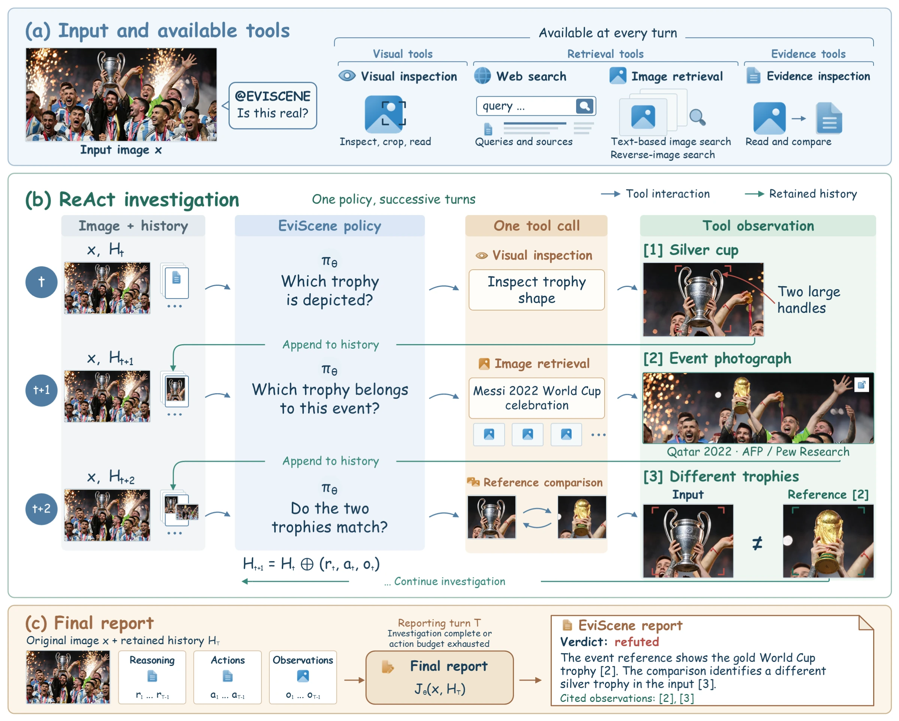

<div align="center">

# EviScene

<strong>Beyond “Is It AI?” for Agentic Image Factuality Assessment</strong>

<p>观察图像，寻找证据，核实事实。</p>

<p>
  <a href="https://wangzian828.github.io/EVISCENE/" style="display: inline-block; margin: 2px 0;"></a>
  <a href="https://arxiv.org/abs/2610.14609" style="display: inline-block; margin: 2px 0;"></a>
  <a href="https://huggingface.co/papers/2610.14609" style="display: inline-block; margin: 2px 0;"></a>
  <a href="https://huggingface.co/ZiAnwang/EviScene" style="display: inline-block; margin: 2px 0;"></a>
</p>

[English](./README.md) · [简体中文](./README_zh-CN.md)

[概览](#overview) · [快速开始](#quick-start) · [模型与数据](#models-and-data) · [实验结果](#results) · [训练](#training) · [评测](#evaluation) · [引用](#citation)

</div>

EviScene 关注图像所描绘的事实是否有证据支持，而不只是判断图像是否由 AI 生成。
给定一张图像，Agent 会检查视觉细节、检索外部证据，并输出判断与基于证据的报告。
推理时不需要用户额外提供文字断言。

本仓库提供 Agent 运行时、工具集成、SFT 与 PSD 训练工具，以及评测代码。

<a id="overview"></a>

## 🔎 项目概览



- **主动寻找证据。** 单一 ReAct 策略根据尚未解决的问题，选择视觉检查、网页搜索、
  图像检索或证据检查。
- **经过训练的紧凑策略模型。** 监督微调（SFT）学习经过审核的教师轨迹；
  特权信息辅助的在线自蒸馏（PSD）利用训练阶段的提示改进选定决策。
  部署后的学生模型不接收这些训练提示。
- **评测不止看最终判断。** EviLens 用于评估图像事实性，评测代码同时衡量分类表现
  和最终报告的事实依据是否充分。

<details>
<summary><strong>代码结构与命令行入口</strong></summary>

| 目录 | 用途 |
| --- | --- |
| `eviscene/` | Agent 运行时、工具与评测 |
| `training/eviscene_training/` | SFT 与 PSD 数据准备及训练适配器 |
| `scripts/` | 数据集准备和评测入口脚本 |

安装后通过 `eviscene` 运行推理，通过 `eviscene-train` 进行训练数据准备。
Python 模块对应使用 `eviscene` 与 `eviscene_training` 命名空间。

</details>

<a id="quick-start"></a>

## 🚀 快速开始

### 1. 安装

请使用 **Python 3.11 或 3.12** 并创建独立环境。以下命令以 Bash 为例；
Windows 用户可在 PowerShell 中通过 `.venv\Scripts\Activate.ps1` 激活环境，
替代 `source` 命令。

```bash
git clone https://github.com/wangzian828/EVISCENE.git
cd EVISCENE
python -m venv .venv
source .venv/bin/activate
python -m pip install -e '.[all]' -e ./training
```

轻量运行时可用
`python -m pip install -e .` 安装；OCR 仅调用百度 API，
`image-retrieval` 可选依赖提供 OSS 图像上传支持。
安装 Python 包**不会**自动下载 EviScene 权重，也不会启动模型服务。
GPU 训练所需依赖另行配置，见[训练](#training)。

### 2. 配置模型和工具

使用 EviScene 权重启动兼容的多模态模型服务。服务需提供支持图像输入的
OpenAI 兼容 chat-completions 接口。URL 和模型名称应与实际服务一致；
下列配置仅为示例，不是可直接调用的在线 EviScene API。

<details>
<summary><strong>必需配置：.env 参数</strong></summary>

在仓库根目录创建本地 `.env` 文件：

```dotenv
# Agent policy and visual tools: your local multimodal server.
QWEN35_LOCAL_BASE_URL=http://127.0.0.1:8000/v1
QWEN35_LOCAL_MODEL=eviscene
QWEN_LOCAL_API_KEY=none

# Text search, image search, and reverse-image search.
SERPER_API_KEY=YOUR_SERPER_API_KEY
VISUAL_SEARCH_PROVIDER=serper_lens

# Fetch readable webpage content through Jina Reader.
BROWSE_FETCH_PROVIDER=jina
JINA_API_KEY=YOUR_JINA_API_KEY

# Upload images to obtain URLs usable by reverse-image search.
IMAGE_UPLOAD_PROVIDER=oss
OSS_ACCESS_KEY_ID=YOUR_OSS_ACCESS_KEY_ID
OSS_ACCESS_KEY_SECRET=YOUR_OSS_ACCESS_KEY_SECRET
OSS_ENDPOINT=YOUR_OSS_ENDPOINT
OSS_BUCKET_NAME=YOUR_OSS_BUCKET_NAME

# 百度 OCR API；工具观察不使用本地缓存。
OCR_BACKEND=baidu
BAIDU_OCR_API_KEY=YOUR_BAIDU_OCR_API_KEY
BAIDU_OCR_SECRET_KEY=YOUR_BAIDU_OCR_SECRET_KEY
TOOL_CACHE_ENABLED=0
PERCEPTION_CACHE_ENABLED=0
```

请替换凭据占位符；模型服务需要鉴权时，也应配置对应 API key。
`.env` 已被 Git 忽略。OCR 会将图像内容发送到百度；不使用本地 OCR 模型，也不回退其他服务。

</details>

**模型推理可以在本地进行，但外部检索并不是离线功能。** 网页搜索、网页读取和图像
托管需要网络访问，可能产生服务费用。反向图像搜索会将输入图像发送到配置的托管与
搜索服务，请仅使用你有权向这些服务提供的图像。

<details>
<summary><strong>进阶配置：本地模型路由与参数覆盖</strong></summary>

项目配置统一使用 `EVISCENE_*` 前缀，例如 `EVISCENE_DATA_ROOT` 指定产物存储目录，
`EVISCENE_ENV_FILE` 指定环境配置文件。已有的 `IFV_*` 配置仍可读取；
显式设置的 `EVISCENE_*` 值优先。`QWEN35_LOCAL_MODEL` 等服务提供方配置名保持不变。

命令行和 Python 接口默认采用 `student-qwen3.5-local`，将策略模型和视觉工具路由到本地模型；云端模型须显式选择。
**网页证据抽取默认使用同一个本地策略模型及服务地址**，无需额外设置抽取器。
如需显式覆盖，可配置 `BROWSE_EXTRACT_PROVIDER`、`BROWSE_EXTRACT_MODEL`、
`BROWSE_EXTRACT_BASE_URL`、`BROWSE_EXTRACT_WIRE_API` 和
`BROWSE_EXTRACT_API_KEY`。已有环境变量或 `.env` 配置仍具有优先级；
如之前设置过 `BROWSE_EXTRACT_PROVIDER=gemini`，需移除该设置才能使用本地默认值。
本地抽取失败时不会自动回退到 Gemini。Gemini 评测是独立的可选步骤，
不属于此推理示例的一部分。

</details>

### 3. 核查一张图像

在仓库根目录运行，并将图像路径替换为你自己的文件：

```bash
eviscene path/to/image.jpg --profile student-qwen3.5-local --output-dir runs/example
```

命令行会输出判断、置信度、评估结果和工具调用统计。对于上述文件名，标准轨迹保存为
`runs/example/image.jpg.json`。可通过以下命令查看推理、工具观察和最终报告：

```bash
python -m eviscene.render_trace_html runs/example/image.jpg.json
```

在浏览器中打开生成的 `runs/example/image.jpg.html`。
运行时的 `real` / `fake` 分别对应事实性标签 supported / refuted，
并不表示图像是否由 AI 生成。模型输出不保证正确，使用结论前请检查引用证据。

<a id="models-and-data"></a>

## 📦 模型与数据

> **项目资源：** 代码、权重、数据文件和论文均已公开。
> [Hugging Face 的 EviScene 项目仓库](https://huggingface.co/ZiAnwang/EviScene)统一存放代码、SFT 与 PSD
> 权重、EviLens 训练集和测试集的图片与元数据，以及论文 PDF。

| 项目 | 内容 | 发布状态 |
| --- | --- | --- |
| [EviScene-SFT](https://huggingface.co/ZiAnwang/EviScene/tree/main/models/sft) | 经过监督微调的 Qwen3.5-9B 策略模型 | 已发布 |
| [EviScene-PSD](https://huggingface.co/ZiAnwang/EviScene/tree/main/models/psd) | 经过 SFT 和 PSD 的 Qwen3.5-9B 策略模型 | 已发布 |
| [EviLens train](https://huggingface.co/ZiAnwang/EviScene/tree/main/datasets/EviLens/train) | 8,647 张图像及配套元数据 | 已发布 |
| [EviLens test](https://huggingface.co/ZiAnwang/EviScene/tree/main/datasets/EviLens/test) | 1,527 张图像及配套元数据 | 已发布 |

Hugging Face 仓库根目录为代码；两个权重分别放在 `models/sft/` 和 `models/psd/`，
论文位于 `paper/EviScene.pdf`。两个模型目录均包含合并后的 safetensors 权重
以及对应的模型配置、tokenizer 和 processor 文件。
数据集位于同一仓库的 `datasets/EviLens/`，下设 `train/` 和 `test/`。
代码许可证不授予模型权重或第三方图片的使用权；请参阅模型卡和数据集说明。
EviLens 图像与元数据划分不同于训练流程所使用的教师轨迹和蒸馏目标。
请勿将测试集用于训练或模型选择。

<a id="results"></a>

## 📊 实验结果

以下为当前论文快照中选取的 EviLens 结果。所有数值均为百分比，越高越好。
这些是论文报告的结果，并非使用本代码快照重新计算的分数。

| Qwen3.5-9B 设置 | BAcc | Macro F1 | Supported 召回率 | Refuted 召回率 | SESR |
| --- | ---: | ---: | ---: | ---: | ---: |
| 直接预测 | 65.70 | 57.26 | 79.05 | 52.35 | 1.70 |
| 基础 Agent | 72.34 | 74.57 | 51.19 | 93.48 | 42.89 |
| SFT 后 | 78.81 | 75.69 | 76.39 | 81.22 | 50.49 |
| **EviScene：SFT + PSD** | **79.05** | 74.67 | 80.11 | 78.00 | **52.26** |

与同一骨干的基础 Agent 相比，SFT + PSD 的 BAcc 提升 **6.71 个百分点**，
SESR 提升 **9.37 个百分点**。同时列出 Macro F1 和分类别召回率，
以展示不同指标之间的取舍，而不是暗示所有指标都获得了提升。

- **BAcc：** supported 和 refuted 两类召回率的平均值。
- **Macro F1：** 两个类别 F1 分数的平均值。
- **SESR：** 严格证据充分率（Strict Evidence Sufficiency Rate），即判断正确且
  对决定性、图像关联的事实提供充分依据的 case 所占比例。

<a id="training"></a>

## 🛠️ 训练

训练流程分为两个阶段：

1. **SFT：** 审核教师核查轨迹，导出通过审核的样本，并转换为策略训练格式。
2. **PSD：** 收集当前策略的在线训练轨迹，定位失败决策，构造程序性提示，验证修复，
   并使用选定的教师分布目标和保留目标进行训练。

| 步骤 | 实现 |
| --- | --- |
| 构建审核后的 SFT 样本 | [`build_sft_training_package.py`](scripts/trajectory/build_sft_training_package.py) |
| 转换策略样本 | [`eviscene-train convert-policy`](training/eviscene_training/policy.py) |
| 收集在线轨迹 | [`collect_psd_rollouts.py`](scripts/collect_psd_rollouts.py) |
| 定位并验证训练失败 | [`run_psd_judge.py`](scripts/run_psd_judge.py) |
| 构造提示并搜索修复 | [`run_psd_repair_driver.py`](scripts/run_psd_repair_driver.py) |
| 构建稀疏教师目标 | [`build-psd-datums`](training/eviscene_training/psd_datums.py) |
| 应用 PSD 训练损失 | [`psd_ms_swift.py`](training/eviscene_training/psd_ms_swift.py) |

可用以下命令查看数据准备工具的参数：

```bash
eviscene-train --help
python -m scripts.trajectory.build_sft_training_package --help
eviscene-train build-psd-datums --help
python -m scripts.run_psd_repair_driver --help
```

轻量包不安装 GPU 训练环境，也不下载权重。
必要参数见[训练配置](training/README.md)，输入字段见[数据接口](docs/data.md)。
配置来自论文，不代表已经独立复现了训练结果。

<a id="evaluation"></a>

## 🔬 评测

Agent 推理与证据判定相互独立。Agent 接收图像，不接收参考标签或评测器专用材料。
Judge 在核查轨迹保存后进行判定。

### 运行 Agent

准备运行时 case 包，以及上述模型与工具配置后：

```bash
python -m eviscene.eval.run_cases \
  --benchmark path/to/runtime_input/cases.jsonl \
  --profile student-qwen3.5-local \
  --output-dir runs/eval-full \
  --concurrency 4 \
  --base-sampling-seed 1729
```

输出包括 `run_manifest.json`、`run_results.jsonl`、`summary.json` 和逐 case 轨迹。
运行时输入须遵循[数据接口](docs/data.md)；任意图像/标签 JSONL
不能直接替代运行时输入。上面的并发度仅是配置服务器的起点，并非论文硬件设置。
[可恢复的 rollout 包装器](scripts/run_agent_test_rollout.py)也支持对兼容的测试发布包
进行有界工程重试。

### 判定保存的核查轨迹

[事后 Judge](scripts/audit_agent_private_gold.py)需要单独提供参考标注，并配置
`GEMINI_API_KEY` 或 `GOOGLE_API_KEY`：

```bash
python -m scripts.audit_agent_private_gold \
  --run-dir runs/eval-full \
  --manifest path/to/test-manifest.jsonl \
  --private-gold-sidecar path/to/test-private-gold.jsonl \
  --output-dir runs/eval-full-judge \
  --judge-model gemini-3.7-flash \
  --thinking-level low \
  --max-output-tokens 32768 \
  --concurrency 4
```

这是一个需要付费调用外部服务的评测步骤。标注路径为占位符，代码仓库不包含
评测器参考材料。仅有公开的图像级标签，不足以复现证据质量审核。
比较结果时应保持数据集版本、case 集合、模型配置和指标分母一致；
失败或未判定的 case 不能作为成功计算。

较大规模运行可使用[流式 Judge](scripts/server/stream_agent_judges.py)，
在推理进行的同时判定已完成的 case。
[汇总脚本](scripts/summarize_agent_test_evaluation.py)用于聚合事后审核记录；
仓库也包含[指标定义](eviscene/eval/private_gold_metrics.py)。

### 工具消融

为 `eviscene.eval.run_cases` 添加一个消融参数，并使用独立输出目录：

| 变体 | 参数 | 移除的工具 |
| --- | --- | --- |
| 去掉网页搜索 | `--disable-web-search` | `text_search` |
| 去掉图像检索 | `--disable-image-retrieval` | `text_image_search`、`reverse_image_search` |
| 去掉证据检查 | `--disable-evidence-inspection` | `visit`、`compare_with_reference` |

三种消融均保留直接视觉操作与最终报告能力。
请固定模型、case 集合、种子和动作预算。
精确的工具族划分见 [`tool_ablation.py`](eviscene/orchestrator/tool_ablation.py)。

<a id="citation"></a>

## 📝 引用

**EviScene: Beyond “Is It AI?” for Agentic Image Factuality Assessment.**

阅读 [arXiv 论文](https://arxiv.org/abs/2610.14609)，
或[下载 BibTeX](https://wangzian828.github.io/EVISCENE/assets/eviscene.bib)。
如使用 EviScene，请引用：

```bibtex
@misc{wang2026evisceneisaiagentic,
  title={EviScene: Beyond "Is It AI?" for Agentic Image Factuality Assessment},
  author={ZiAn Wang and Ruiqi Liu and Zhengbo Zhang and Yi Han and
          Jialiang Shen and Ruoxin Chen and Manni Cui and Ximo Zhu and
          Jin Jiang and Mingzhe Liu and Linhao Wang and Wenhao Wang and Shu Wu},
  year={2026},
  eprint={2610.14609},
  archivePrefix={arXiv},
  primaryClass={cs.CV},
  url={https://arxiv.org/abs/2610.14609},
}
```

## ⚖️ 许可证

代码采用 [Apache-2.0](LICENSE)，另见 [NOTICE](NOTICE)。
权重、数据和论文分别授权；代码许可证不替代上游模型、图像或服务的条款。

开发检查见 [Contributing](CONTRIBUTING.md)，安全注意事项见 [Security](SECURITY.md)。
仓库 CI 仅做代码与打包检查；测试和测试数据不随仓库发布。
软件引用信息见 [CITATION.cff](CITATION.cff)。
